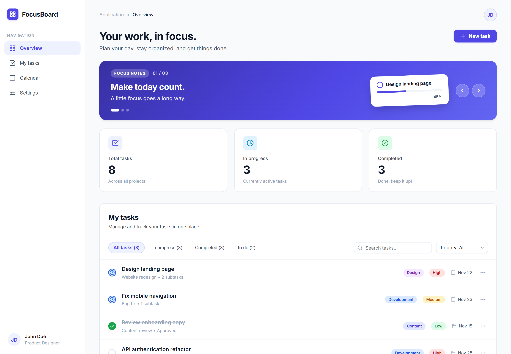
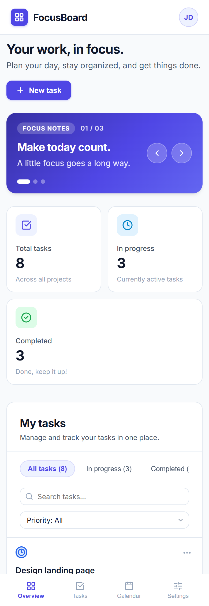

# FocusBoard — Dashboard

A responsive, single-user task dashboard built with React, Vite, and TypeScript, faithfully imitating the Figma reference design.



---

## Live Application
- **Hosted URL**: [https://focus-dashboard.vercel.app](https://focus-dashboard.vercel.app) *(or your deployed URL)*
- **GitHub Repository**: [https://github.com/shaik/focusboard](https://github.com/shaik/focusboard)

---

## Key Features

1. **Task Operations**:
   - **Create Task**: Add new tasks with title, description, category, status, priority, and due date. Validates required fields with inline feedback.
   - **Edit Task**: Open existing task in prefilled modal, modifying fields in place with instantaneous updates across all views.
   - **Delete Task**: Accessible confirmation dialog (`alertdialog`) before destructive actions, preventing accidental deletions.
   - **Instant Status Toggle**: Fast one-click cycling between `To do`, `In progress`, and `Completed`, plus explicit assignment via the row action menu.

2. **Compose Filtering & Search**:
   - **Search**: Case-insensitive instant filtering across task titles.
   - **Status Tabs**: Fast switching between `All tasks`, `In progress`, `Completed`, and `To do` with dynamic counters.
   - **Priority Filter**: Dropdown filtering by `All`, `High`, `Medium`, and `Low`.
   - **Composed Intersections**: Search query, status tab, and priority filter work simultaneously without clobbering one another.
   - **Empty State**: Friendly illustration and one-click "Reset all filters" button when no tasks match.

3. **Derived Statistics (Never Hardcoded)**:
   - **Total Tasks**: Calculated dynamically from task list length.
   - **In Progress Count**: Derived from active tasks.
   - **Completed Count & Rate**: Derived percentage displayed dynamically in overview.

4. **Focus Notes Carousel**:
   - Exactly three slides strictly matching the provided Figma design copy and structure.
   - Floating task card preview with progress bar and status indicator.
   - Prev/Next navigation with continuous wrap-around behavior.
   - Synchronized active indicator dots that are also directly clickable and keyboard accessible.

5. **Safe Browser Persistence**:
   - Uses versioned localStorage key (`focusboard.tasks.v1`).
   - Safely reads, parses, and validates data on initial boot.
   - Preserves saved user state across page refreshes.
   - Does **not** overwrite saved tasks with sample data upon reloads.

---

## Tech Stack
- **Framework**: React 19 + Vite 8
- **Language**: TypeScript with strict mode
- **Styling**: CSS with Design Tokens (colors, spacing, shadows, radii) matching Figma
- **Icons**: Lucide React
- **Testing**: Vitest + React Testing Library + jsdom
- **State Architecture**: React Context + `useReducer` for predictable, unidirectional data flow

---

## Getting Started

### Prerequisites
- Node.js v18+ (tested on Node v24)
- npm or pnpm

### Installation
```bash
# Navigate to project directory
cd focusboard

# Install dependencies
npm install

# Start development server
npm run dev
```

### Running Tests
The project includes a 16-test suite verifying every single requirement in `07_ACCEPTANCE_TESTS.md`:
```bash
npm test
```

### Production Build
```bash
# Type check and build bundle
npm run build

# Preview production build locally
npm run preview
```

---

## State Management Architecture

State is managed via **React Context + `useReducer`** in `src/providers/TaskProvider.tsx`:
- **Single Source of Truth**: The `tasks` array is the only stored task data.
- **Predictable Mutations**: Actions (`task/add`, `task/update`, `task/delete`, `task/set-status`, `tasks/hydrate`) produce immutable new state arrays without side-effects.
- **Computed / Derived Values**: `total`, `inProgress`, `completed`, `todo`, and `completionPercentage` are computed via `useMemo` from the current `tasks` state. They are never stored as separate, mutable state to eliminate synchronization bugs.
- **Composed Filters**: Filter state (`search`, `statusTab`, `priority`) is managed as reactive UI state. The visible `filteredTasks` list is computed via an intersection predicate:
  ```ts
  const matchesSearch = query === "" || task.title.toLowerCase().includes(query);
  const matchesStatus = filters.statusTab === "all" || task.status === filters.statusTab;
  const matchesPriority = filters.priority === "all" || task.priority === filters.priority;
  return matchesSearch && matchesStatus && matchesPriority;
  ```

---

## Persistence Strategy

1. **Keyed Storage**: Saved under `focusboard.tasks.v1` in `localStorage`.
2. **Safe Hydration**: On initial render, `loadTasks()` inspects `localStorage`. If a valid JSON array exists, it is used immediately.
3. **First-Visit Seeding**: Only if `localStorage` has no record (first visit) does the app initialize with the 8 sample tasks.
4. **Auto-Persist**: A `useEffect` synchronizes any task list changes back to `localStorage` safely.

---

## Visual Design & Figma Fidelity

The application implements the visual styling of the reference Figma design:
- **Color Palette**: Deep brand indigo (`#4F46E5`), surface whites (`#FFFFFF`), subtle borders (`#E2E8F0`), canvas background (`#F8FAFC`), and matching status/priority badge palettes.
- **Typography**: Inter typeface with clean weights (400, 500, 600, 700) and strict hierarchy.
- **Overview Cards**: 3 metric cards with matching icon backgrounds (`purple`, `blue`, `green`) and descriptive subtext.
- **Focus Notes Carousel**: Gradient banner (`linear-gradient(135deg, #3730A3, #4F46E5, #6366F1)`) with exact slide copy:
  1. *Make today count.* / *A little focus goes a long way.* (01 / 03)
  2. *Small steps, big progress.* / *Keep your momentum going.* (02 / 03)
  3. *Celebrate the wins.* / *Every finished task moves you forward.* (03 / 03)
- **Responsive Layout**:
  - **Desktop (1440px)**: Left navigation rail, breadcrumb bar, full-width Focus Notes banner, 3 stat cards, tabular task rows.
  - **Tablet (768px)**: Reflowed stat cards, wrapping toolbar, responsive table list.
  - **Mobile (390px)**: Fixed mobile top bar, stacked task cards with status circle and pill badges, bottom fixed navigation bar (`Overview`, `Tasks`, `Calendar`, `Settings`).

---

## Accessibility (a11y)

- **Semantic HTML**: `<aside>`, `<header>`, `<main>`, `<nav>`, `<section>`, `role="list"`, `role="listitem"`.
- **Keyboard Navigation**: All controls (buttons, inputs, select dropdowns, modal close, carousel arrows and indicators) are fully keyboard operable.
- **Focus Indicators**: High-contrast, visible `:focus-visible` ring on all interactive elements.
- **ARIA & Dialogs**:
  - Modal forms use `role="dialog"` with `aria-modal="true"`, `aria-labelledby`, and escape key dismissal.
  - Delete prompt uses `role="alertdialog"`.
  - Carousel uses `role="region"`, `aria-roledescription="carousel"`, `role="group"`, `aria-roledescription="slide"`, and tablist pagination.
- **Color Independence**: Status and priority are communicated through text labels and icons, not color alone.
- **Reduced Motion**: Respects `prefers-reduced-motion: reduce` by disabling transitions.

---

## Screenshots

### Desktop (1440 × 1000)


### Mobile (390 × 1128)


---

## Limitations & Placeholders
- **Sidebar Tabs (`Calendar`, `Settings`)**: Navigation tabs outside the primary task dashboard display their active state but do not navigate to separate pages, as per assignment scope ("Do not create extra product screens beyond the assessment scope").
