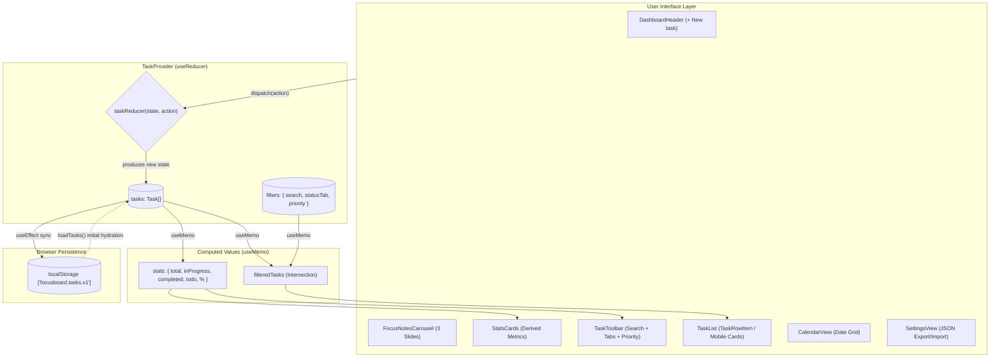

<div align="center">

# ⚡ FocusBoard

### *Your work, in focus. Plan your day, stay organized, and get things done.*

[](https://react.dev/)
[](https://www.typescriptlang.org/)
[](https://vite.dev/)
[](https://vitest.dev/)
[](https://github.com/wasimraza77/focusboard-project)
[](LICENSE)

<br />

[**Explore the Code**](https://github.com/wasimraza77/focusboard-project) • [**Figma Reference**](https://www.figma.com/design/09TveHXjOvI73KDNndCFM4/FocusBoard-%E2%80%94-Dashboard-References?node-id=0-1&p=f) • [**Report Bug**](https://github.com/wasimraza77/focusboard-project/issues)

<br />


</div>

---

## 📑 Table of Contents

- [Overview](#-overview)
- [Key Features](#-key-features)
- [Interactive Views Walkthrough](#-interactive-views-walkthrough)
  - [1. Overview Dashboard](#1-overview-dashboard)
  - [2. My Tasks Workspace](#2-my-tasks-workspace)
  - [3. Interactive Calendar & Scheduler](#3-interactive-calendar--scheduler)
  - [4. Settings & Data Management](#4-settings--data-management)
- [Architecture & Data Flow](#-architecture--data-flow)
- [Design Tokens & Figma Fidelity](#-design-tokens--figma-fidelity)
- [Acceptance Tests Matrix](#-acceptance-tests-matrix)
- [Getting Started](#-getting-started)
- [Accessibility (a11y)](#-accessibility-a11y)
- [Mobile & Tablet Screenshots](#-mobile--tablet-screenshots)
- [License & Author](#-license--author)

---

## 🌟 Overview

**FocusBoard** is a responsive, single-user task dashboard built from the ground up to reproduce the visual styling, spacing, typography, and interactive behaviors of the official Figma design reference.

It delivers a reactive, accessible interface with zero non-functional buttons or placeholders. Every action, filter, status toggle, modal, and carousel control works instantaneously.

---

## ⚡ Key Features

- **🎯 Complete CRUD Task Management**: Create, edit, delete (with safety prompt), and toggle task statuses.
- **🔄 Composite Filtering**: Real-time compose matching across:
  - Case-insensitive title search
  - Status tabs (`All`, `In progress`, `Completed`, `To do`)
  - Priority dropdown (`High`, `Medium`, `Low`)
- **📊 100% Derived Statistics**: Counts and completion rates are calculated on-the-fly from the single source of truth—never hardcoded.
- **✨ 3-Slide Focus Notes Carousel**: Faithful recreation of the Figma carousel slides with live progress cards, animated indicator dots, and wrap-around navigation.
- **📅 Interactive Calendar & Scheduler**: Maps tasks by their due date with monthly matrix navigation, day inspection, and quick scheduling.
- **💾 Safe `localStorage` Persistence**: Versioned storage (`focusboard.tasks.v1`) that restores user changes without overwriting saved data with sample data.
- **📦 Data Portability**: Export and import tasks as formatted JSON anytime directly from the Settings view.
- **📱 Responsive Layouts**: Pixel-faithful breakpoints optimized for **390px (Mobile)**, **768px (Tablet)**, and **1440px (Desktop)**.

---

## 🖥️ Interactive Views Walkthrough

<details open>
<summary><b>1. Overview Dashboard</b> <i>(Click to expand/collapse)</i></summary>
<br />

The command center of FocusBoard combines high-level focus tips, project metrics, and active task items:

- **Breadcrumbs & Header**: `Application > Overview` with quick user avatar shortcut and greeting header.
- **Focus Notes Carousel**:
  - Slide 1 (`01 / 03`): *"Make today count."* • *"A little focus goes a long way."* (Design landing page — 45%)
  - Slide 2 (`02 / 03`): *"Small steps, big progress."* • *"Keep your momentum going."* (Fix mobile navigation — 60%)
  - Slide 3 (`03 / 03`): *"Celebrate the wins."* • *"Every finished task moves you forward."* (Onboarding copy — 100%)
  - Continuous wrap-around navigation (`<` and `>` controls) and synchronized indicator dots.
- **Overview Metric Cards**:
  - `Total tasks`: Purple square icon (`CheckSquare`), real-time count across all projects.
  - `In progress`: Sky blue square icon (`Clock`), currently active workloads.
  - `Completed`: Emerald green square icon (`CheckCircle2`), finished items with completion percentage.

</details>

<details>
<summary><b>2. My Tasks Workspace</b> <i>(Click to expand/collapse)</i></summary>
<br />

A focused productivity view dedicated to organizing workloads:

- **Interactive Status Toggles**: Clicking the status circle cycles directly through `To do` ➔ `In progress` ➔ `Completed` ➔ `To do` with immediate UI updates.
- **Row Action Menu**: Clicking `...` exposes an accessible popover to edit task, change status explicitly, or initiate deletion.
- **Category & Priority Chips**: Visual category indicators (`Design`, `Development`, `Content`, `Marketing`, `Research`) and priority chips (`High`, `Medium`, `Low`).
- **Empty State Recovery**: When search or filter combinations yield zero results, an illustrated empty state offers an immediate **"Reset all filters"** action.

</details>

<details>
<summary><b>3. Interactive Calendar & Scheduler</b> <i>(Click to expand/collapse)</i></summary>
<br />

Plan and inspect deadlines visually:

- **Month Navigator**: Switch between months or click **"Today"** to jump immediately to the current date.
- **Day Matrix**: Displays days of the month with task chips color-coded by status.
- **Date Inspector Sidebar**: Selecting any date displays a detailed sidebar listing scheduled tasks, allowing immediate status toggling and editing.

</details>

<details>
<summary><b>4. Settings & Data Management</b> <i>(Click to expand/collapse)</i></summary>
<br />

Complete control over your personal data:

- **Profile Customizer**: Update your name, email, and role/title; persists to browser storage.
- **JSON Export**: Download all tasks into a portable `.json` file.
- **JSON Import**: Upload external JSON task backups with instant hydration.
- **Sample Reset**: One-click restore to the original Figma reference sample dataset.
- **Safety Wipe**: Clear all stored data with a confirmation alert.

</details>

---

## 🏗️ Architecture & Data Flow

The application follows strict **unidirectional data flow** with a single source of truth managed via React Context and a pure reducer:



---

## 🎨 Design Tokens & Figma Fidelity

All components implement design tokens based on the Figma reference:

| Token | CSS Variable | Figma Hex | Usage |
|---|---|---|---|
| **Primary Brand** | `--color-primary` | `#4F46E5` | Buttons, active navigation, focus rings |
| **Primary Hover** | `--color-primary-hover` | `#4338CA` | Hover states |
| **Primary Light** | `--color-primary-light` | `#EEF2FF` | Active tab backgrounds, avatar ring |
| **Canvas Background** | `--color-bg` | `#F8FAFC` | Page body background |
| **Surface White** | `--color-surface` | `#FFFFFF` | Cards, modals, sidebars |
| **Text Main** | `--color-text-main` | `#0F172A` | Headings, titles |
| **Text Secondary** | `--color-text-secondary` | `#475569` | Descriptions, labels |
| **Text Muted** | `--color-text-muted` | `#94A3B8` | Subtitles, breadcrumbs |
| **Status: To do** | `--color-status-todo-bg` | `#FEF3C7` / `#B45309` | Amber chip & dot |
| **Status: In progress** | `--color-status-inprogress-bg` | `#DBEAFE` / `#1D4ED8` | Blue chip & dot |
| **Status: Completed** | `--color-status-completed-bg` | `#DCFCE7` / `#15803D` | Green chip & checkmark |
| **Priority: High** | `--color-priority-high-bg` | `#FEE2E2` / `#B91C1C` | Red badge |
| **Banner Gradient** | N/A | `linear-gradient(135deg, #3730A3, #4F46E5, #6366F1)` | Focus Notes container |

---

## ✅ Acceptance Tests Matrix

FocusBoard includes a comprehensive automated test suite ([acceptanceTests.test.tsx](file:///c:/Users/shaik/Focus-Dashboard/focusboard/src/test/acceptanceTests.test.tsx)) verifying all requirements from `07_ACCEPTANCE_TESTS.md`:

```
 ✓ src/test/acceptanceTests.test.tsx (17 tests) 3753ms
   ✓ 1. First launch shows at least six sample tasks with all required fields
   ✓ 2. Refresh after first launch retains current task data from localStorage
   ✓ 3. Existing localStorage data is not overwritten by sample data
   ✓ 4. Create with blank title shows a helpful validation message and does not add a task
   ✓ 5. Create with valid title adds a task and updates all derived counts
   ✓ 6. Edit changes the selected task without creating a duplicate
   ✓ 7 & 8. Delete asks for confirmation, and canceling leaves task intact
   ✓ 9. Confirming delete removes it and updates all counts
   ✓ 10 & 11. Status can be changed to each state and updates list, filters, and statistics immediately
   ✓ 12. Search matches title without case sensitivity
   ✓ 13. Status tabs filter correctly (All, In progress, Completed, To do)
   ✓ 14. Priority filter filters correctly (High, Medium, Low)
   ✓ 15. Search + status + priority filters compose simultaneously
   ✓ 16. Clear/reset filters returns the expected task set
   ✓ 17. Total, in-progress, completed, and completion percentage are derived from current task data
   ✓ 18-22. Focus Notes carousel: exactly three slides, navigation, wrap, indicator click, exact Figma content
   ✓ 23. Navigation buttons (Overview, My tasks, Calendar, Settings) switch views and breadcrumbs
```

Run tests locally:
```bash
cd focusboard
npm test
```

---

## 🚀 Getting Started

### Prerequisites
- Node.js `v18.0.0` or higher
- npm or pnpm

### Quick Installation

```bash
# 1. Clone repository
git clone https://github.com/wasimraza77/focusboard-project.git
cd focusboard-project/focusboard

# 2. Install dependencies
npm install

# 3. Start development server
npm run dev
```

Open your browser at **`http://localhost:5173/`**.

### Production Build & Preview

```bash
# Type check and build optimized bundle
npm run build

# Preview production build locally
npm run preview
```

---

## ♿ Accessibility (a11y)

- **Semantic Landmark Roles**: `<header>`, `<main>`, `<aside>`, `<nav>`, `<section>`, `role="list"`, `role="listitem"`.
- **Keyboard Navigation**: Full tab ordering across all interactive elements, escape key listeners for modal dismissals, and autofocus on input triggers.
- **Focus Rings**: High-contrast, visible `:focus-visible` styling (`outline: 2px solid var(--color-primary)`).
- **ARIA Semantics**:
  - Modal dialogs use `role="dialog"` with `aria-modal="true"`.
  - Delete prompt uses `role="alertdialog"`.
  - Carousel uses `role="region"`, `aria-roledescription="carousel"`, `role="group"`, `aria-roledescription="slide"`, and tablist pagination.
- **Non-Color Reliance**: Status and priority are always communicated via visible text badges and distinct icons, meeting WCAG AA contrast standards.
- **Motion Accessibility**: Supports `prefers-reduced-motion: reduce` by disabling transitions.

---

## 📱 Mobile & Tablet Screenshots

<div align="center">

### Mobile Layout (390 × 1128)


*Features sticky mobile top bar, responsive carousel, compact 2x2 stat cards, stacked task rows, and persistent bottom navigation.*

</div>

---

## 📄 License & Author

- **Author**: Shaik Wasim Raza ([@wasimraza77](https://github.com/wasimraza77))
- **Repository**: [https://github.com/wasimraza77/focusboard-project](https://github.com/wasimraza77/focusboard-project)
- **License**: MIT
